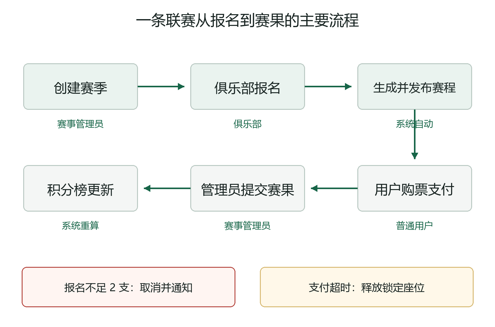
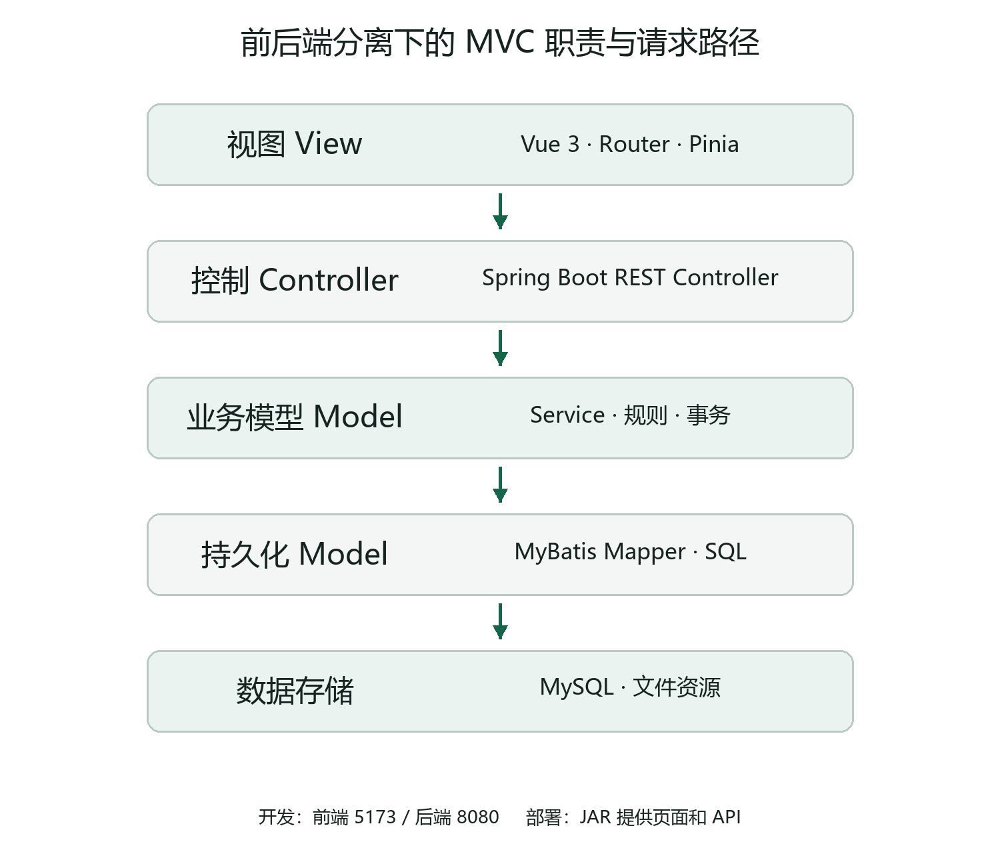
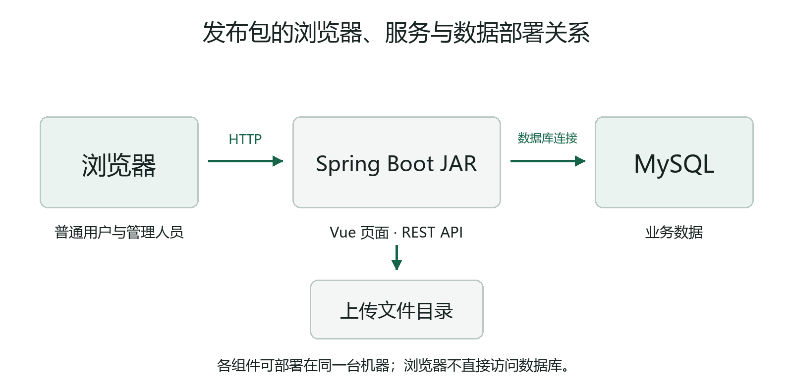
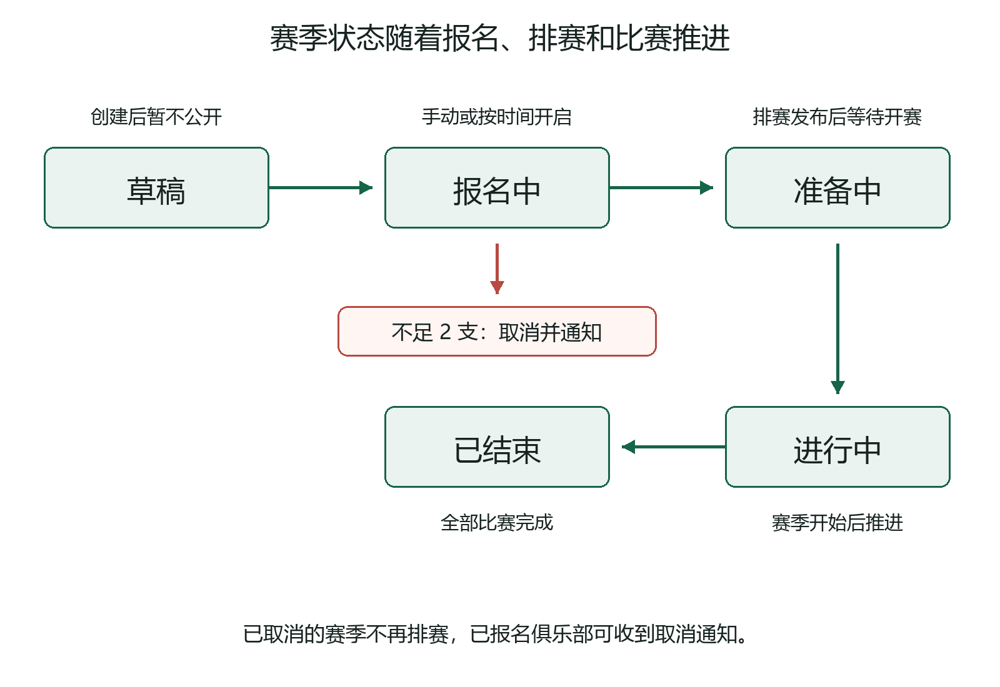
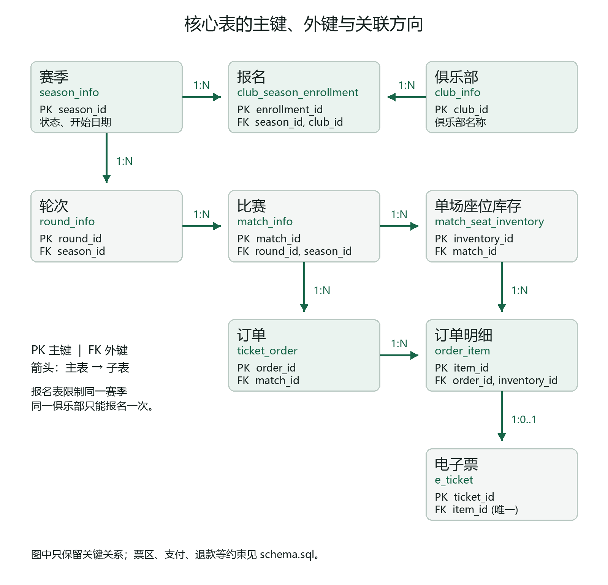

# 足球联赛管理与在线票务系统课程设计总报告

摘要：本项目把足球联赛的组织工作和观众购票放在同一套系统里。俱乐部负责人维护球队并报名，赛事管理员创建赛季和处理赛果，普通用户查看赛程、购票和退票，系统管理员管理账号与基础资料。项目采用 Vue 3 前端、Spring Boot 后端和 MySQL 数据库，重点解决报名到排赛的状态衔接、同一座位不能重复出售、订单支付后生成电子票等问题。本文按照课程设计要求，说明需求、设计、开发方法、遇到的问题和测试结果。支付仅为课程演示中的模拟支付，不接入真实资金通道。

关键词：足球联赛；赛季管理；在线票务；MVC 职责划分；座位库存

# 1 引言

## 1.1 项目背景

线下组织一项足球联赛，往往要分别处理球队报名、比赛安排、门票销售和赛果统计。如果这些信息放在不同表格或群消息里，管理员容易弄错时间，球迷也难以找到准确的赛程和余票。课程设计需要一套真正能运行、有前后端和数据库的系统，因此我们选择把这些环节串起来，做成足球联赛管理与在线票务系统。

本项目不是职业赛事的商业平台。它面向课程演示场景，保留联赛业务中最能体现软件工程方法的部分：多角色权限、赛季生命周期、主客场双循环排赛、按时间自动售票、座位锁定、模拟支付、电子票、自动退票和赛果确认。独立检票员模块虽有历史代码，当前正式版本不作为验收范围。

## 1.2 开发目的与应用范围

开发目的有两层。对使用者而言，普通用户能够在一个页面链路中完成“找比赛—买票—查看电子票”；俱乐部负责人能维护人员和主场并报名；管理员可以跟进赛季、比赛与订单。对课程设计而言，项目用实际业务检验需求分析、分层设计、数据库约束、事务处理和自动化测试是否配合得上。

系统用于本地或教学环境的浏览器访问。前端开发服务默认运行在 5173 端口，后端 API 默认运行在 8080 端口，MySQL 保存业务数据。部署时也可以把前端页面打包进后端 JAR，由一个服务同时提供页面和 API。

# 2 需求分析

## 2.1 使用者与职责

系统当前正式使用四类角色。权限按业务责任分开，避免普通用户修改比赛，也避免俱乐部负责人查看或处理其他俱乐部的内部数据。

| 角色 | 主要任务 | 典型操作 |
| --- | --- | --- |
| 普通用户 USER | 找比赛和购票 | 浏览赛季、选择票种、提交订单、模拟支付、查看电子票、申请退票 |
| 俱乐部负责人 CLUB | 维护本队并报名 | 编辑俱乐部资料、球员与教练、主场配置、报名赛季、查看本队赛程 |
| 赛事管理员 EVENT_ADMIN | 组织联赛 | 创建赛季、查看报名、维护比赛、提交比分、查看赛果待办与统计 |
| 系统管理员 ADMIN | 管理平台基础资料 | 管理账号与俱乐部、审核负责人、处理需人工确认的赛果 |

## 2.2 业务流程

完整流程从“创建赛季”开始。草稿赛季不公开；报名开启后，合规俱乐部在截止前提交报名；满额或截止时系统排赛并发布。比赛公开后，球迷在自动售票时间内下单，支付成功取得电子票。比赛结束后，赛事管理员提交比分，系统按多人确认规则发布赛果，再重算积分榜。图 2-1 把管理流程和用户流程放在同一条时间线上。



实际使用时也会遇到分支：报名截止时不足两支球队，赛季取消并通知已报名俱乐部；用户超过支付时限，订单关闭，锁住的座位重新释放；赛果存在分歧，则进入管理员确认流程。这些分支不能只在页面上提示，后端状态和数据库记录也必须一致。

## 2.3 功能需求

普通用户需要按赛季、轮次和比赛查看信息，看到票区价格及可售状态。购票时选择票种和人数，系统分配真实座位，避免一个座位卖给两个人。订单支付成功后生成与乘客身份、比赛和座位对应的电子票；符合时间条件时可退票。

俱乐部负责人需要维护本队球员、教练和主场。报名时，系统校验报名时间、参赛名额、赛季冲突、球队人员和主场配置，保存当时报名人员快照。这样以后修改球员资料，也不会悄悄改变已经提交的报名名单。

赛事管理员需要创建和管理赛季，查看报名和赛程，维护比赛信息并独立提交比分。比分由不同管理员共同确认；如果提交结果有冲突，则交由系统管理员处理。系统管理员还负责内部账号、俱乐部基础信息等平台级工作。

## 2.4 关键业务规则

| 业务点 | 当前实现的规则 |
| --- | --- |
| 报名窗口 | 默认在赛季开始前第 30 天 20:00 开启，开始前第 15 天 19:59 截止；管理员可提前手动开启 |
| 赛程 | 至少 2 支球队；采用主客场双循环；同一球队相邻比赛至少间隔 6 天 |
| 售票 | 每场比赛在比赛日期前 14 天 20:00 自动开售，开球前 1 小时停止销售；还需比赛已发布、票区启用且有库存 |
| 订单 | 每单票数受系统配置限制；默认支付时限为 15 分钟；逾期后释放锁定座位 |
| 退票 | 只允许对符合条件的已支付订单退票；距开球不足 24 小时不受理；退款比例按比赛时间判断 |
| 赛果 | 比赛开始前不能提交比分；不同赛事管理员一致提交可自动发布，冲突交由系统管理员确认 |

## 2.5 非功能需求

系统在安全上采用登录令牌和角色权限控制；密码以哈希保存，接口按当前登录用户限制数据范围。购票、支付和退票使用数据库事务与状态校验，避免产生“钱已付但没有票”或“票已卖但座位仍可买”的记录。界面需要在电脑和手机宽度下可读，中文错误信息应能帮助使用者纠正输入。课程演示需要可重复初始化的数据库脚本和可执行的启动方法，但不把模拟支付描述成真实支付服务。

# 3 项目设计

本章按系统架构、功能模块和数据库三个方面展开。设计只描述当前仓库中的浏览器端、后端服务和 MySQL 业务，不把样例文档中的移动端或货运业务照搬进来。

## 3.1 系统架构设计

### 3.1.1 系统软件架构设计

系统采用前后端分离结构，并借鉴 MVC 划分职责。Vue 页面负责展示和基础表单校验；Spring Boot Controller 接收 HTTP 请求；Service 处理业务规则、权限和事务；MyBatis Mapper 访问 MySQL。图 3-1 给出一次请求经过的主要层次。



这里的 View 是 Vue 页面，Controller 是 REST 控制器，Model 包括业务实体、Service 规则和持久化数据，并不是由 Spring 在服务端直接生成 HTML。Pinia 可以保存登录状态，但库存、订单和赛季状态仍以服务端数据为准。

| 层次 | 项目中的实现 | 主要职责 |
| --- | --- | --- |
| 界面层 | Vue 页面、Router、Pinia | 展示数据、收集输入、组织页面跳转 |
| 接口控制层 | Spring Boot Controller | 接收请求、检查参数和身份、返回结果 |
| 业务逻辑层 | Service 与事务 | 判断报名、排赛、售票和赛果规则 |
| 数据访问层 | MyBatis Mapper | 查询和更新业务表 |
| 数据层 | MySQL 与上传文件目录 | 保存业务记录和图片文件 |

以购票为例，页面可以提示当前是否开售，但真正的下单条件仍由后端 Service 统一判断。这样即使用户绕过页面直接请求接口，也不能只凭前端按钮状态完成购票。

### 3.1.2 系统硬件架构设计

系统通过浏览器访问，不要求专用客户端。开发模式下，Vite 前端、Spring Boot 后端和 MySQL 可以分别运行；仓库的发布包则由 Spring Boot JAR 同时提供页面和 API，仍需连接 MySQL。上传图片保存在服务端配置的目录。图 3-2 表示发布时的部署关系，不代表这些组件必须各占一台物理服务器。



浏览器只与 Web 服务交换页面、接口数据和上传文件；数据库由后端访问，用户端不直接连接 MySQL。数据库连接、令牌密钥和上传目录通过运行配置提供，报告不假定固定的机器型号或服务器数量。

## 3.2 系统功能模块设计

功能按使用者和业务链拆分为账户与权限、俱乐部与报名、赛季排赛、票务订单、赛果积分等模块。报名数据决定参赛球队，排赛生成比赛和票务基础数据，订单改变逐座库存，正式赛果更新积分榜。模块之间通过后端服务衔接，而不是由页面直接改表。

### 3.2.1 账户与权限模块设计

系统有普通用户、俱乐部负责人、赛事管理员和系统管理员四类正式角色。登录以手机号和角色定位账号；管理角色还要校验工号。服务端根据令牌重新读取账号及角色，不能只信任前端保存的角色名称。

| 操作 | 主要输入或条件 | 处理结果 |
| --- | --- | --- |
| 普通用户注册 | 手机号、密码和用户资料 | 创建普通用户账号 |
| 俱乐部负责人申请 | 手机号、俱乐部申请信息 | 等待系统管理员审核 |
| 管理人员启用 | 已预登记的管理账号与工号 | 首次启用后允许登录 |
| 登录 | 手机号、密码、角色及必要的工号 | 校验通过后签发令牌 |

例如俱乐部负责人申请不是立即拥有已审核俱乐部的管理权限；审核及账号状态检查必须由后端完成。已停用或待启用账号也不能只靠隐藏菜单限制访问。

### 3.2.2 俱乐部报名与赛季排赛模块设计

俱乐部负责人先维护人员阵容和标准主场，再提交赛季报名。后端检查报名窗口、名额、人员与主场是否合规，并保存报名时的球员、教练和主场快照。这样后来修改俱乐部资料，不会改变已提交的参赛名单。

赛季按草稿、报名中、准备中、进行中、已结束推进；报名截止时不足两支球队则取消并通知已报名俱乐部。图 3-3 展示了主要状态变化。



满足排赛条件后，系统按主客场双循环生成赛程。若有 n 支球队，比赛总数为 n×(n−1)；同一对球队分别在双方主场交手。奇数队排赛时使用轮空占位，但不生成轮空比赛。日期安排还要保证同一球队相邻比赛至少间隔 6 天，生成后保存轮次、比赛和票务基础记录。

### 3.2.3 票务与订单模块设计

比赛发布后，单场售票时间按比赛日期计算：开赛前第 14 天的 20:00 开售，比赛开始前 1 小时停售。普通用户选择票种和数量，后端检查时间、票区和实时库存，再从可售座位中尽量安排连座。一笔订单只使用一个实际票区。

座位随订单依次从可售变为锁定、已售；待支付订单超时或取消后，锁定座位恢复可售。下单时锁座并写入订单明细，模拟支付成功后生成电子票。订单明细保存购票人、座位和票价快照，避免后续资料变化影响历史订单。

### 3.2.4 赛果与积分模块设计

赛事管理员分别提交比赛比分，同一管理员不能重复提交同一场比赛。两名不同管理员提交一致比分时，系统可以发布正式赛果；发生冲突时交由系统管理员确认。只有正式赛果参与积分重算，积分榜的球队范围以本赛季报名记录为准，不能把未参赛俱乐部加入排名。

## 3.3 系统数据库设计

### 3.3.1 逻辑结构设计

数据库以赛季、俱乐部、报名、轮次、比赛、座位库存、订单和电子票为核心实体。一个赛季有多条报名和轮次；一轮有多场比赛；一场比赛对应多个座位库存记录；一个订单可包含多张票。图 3-4 标出主要实体及关系，省略了票区、支付和退款等辅助表。



报名表连接赛季和俱乐部，并保存报名时的主场及人员快照入口。比赛表同时关联赛季、轮次、主客队和场馆；订单明细指向具体座位，电子票与订单明细一一对应。这些关系使赛程、订单和电子票能够追溯到同一批业务记录。

### 3.3.2 物理结构设计

数据库使用 MySQL，完整建表语句以仓库中的 `database/schema.sql` 为准。表 3-1 只列报告涉及的核心表，不把示意关系图当作完整数据库结构。

| 数据表 | 关键字段或约束 | 作用 |
| --- | --- | --- |
| season_info | season_id 主键、season_name 唯一 | 保存赛季时间与状态 |
| club_season_enrollment | season_id 与 club_id 联合唯一 | 保存俱乐部报名 |
| round_info 与 match_info | 轮次和比赛通过赛季关联 | 保存轮次、对阵与开赛时间 |
| match_seat_inventory | match_id 与 stadium_seat_id 联合唯一 | 记录每场比赛的逐座库存 |
| ticket_order 与 order_item | 订单号唯一、明细关联具体座位 | 保存订单与每张票 |
| payment_record 与 e_ticket | 支付关联订单、电子票关联明细 | 保存模拟支付与电子票 |

表 3-2 以逐座库存表为例，说明物理字段怎样支持“同一场比赛的一张座位只能卖一次”。状态取值和锁座字段的配套约束都写在建表 SQL 中。

| 字段 | 类型与约束 | 作用 |
| --- | --- | --- |
| inventory_id | BIGINT UNSIGNED，主键 | 标识一条座位库存 |
| match_id | BIGINT UNSIGNED，外键 | 指向所属比赛 |
| stadium_seat_id | BIGINT UNSIGNED，外键 | 指向物理座位 |
| inventory_status | VARCHAR(16)，非空 | 可售、锁定、已售或停用 |
| lock_order_id | BIGINT UNSIGNED，可空 | 锁定时指向订单 |
| version | INT UNSIGNED，默认 0 | 支持并发更新校验 |

`match_id` 与 `stadium_seat_id` 的联合唯一约束防止一场比赛重复生成同一座位。数据库约束能防止重复记录和非法状态，但“是否处于报名窗口”“当前能否下单”等跨表规则还需由 Service 检查。

# 4 项目开发

## 4.1 技术方案

前端使用 Vue 3、Vue Router、Pinia、Element Plus 和 Vite。Vue 页面按角色拆分，Router 管理访问路径，Pinia 保存登录状态及需要跨页面同步的少量状态。后端使用 Java 17 兼容目标、Spring Boot 3.5、Spring Security、MyBatis 和 Maven。MySQL 存储业务数据，SQL 文件负责初始化数据库。

请求大致沿着“页面—API—Controller—Service—Mapper—MySQL”运行。Controller 不直接拼装复杂 SQL；Service 判断角色、状态与时间，并用事务把一组更新作为一个整体提交。后端对外返回统一结果结构，前端再展示数据或明确的错误提示。

以创建购票订单为例，`TicketZoneList.vue` 收集票种、人数和购票人后，通过前端 API 向 `POST /api/orders` 发请求。`OrderController` 校验登录角色与请求参数，再调用 `OrderServiceImpl.create`。Service 检查开售时间和实时库存，在事务内选择并锁定座位、写入订单与明细；`MatchSeatInventoryMapper` 执行具体的数据库查询和更新。最后 Controller 把结果作为 JSON 返回，Vue 页面跳转到订单详情。View 不直接改数据库，Controller 不承担选座算法，业务规则集中在 Model 一侧。

## 4.2 关键模块的实现

### 4.2.1 报名与自动排赛

创建赛季时，后端根据开始日期推导报名时间，并检查赛季名称、开始日期和球队上限。俱乐部提交报名时先锁定赛季行，再检查名额、时间冲突、人员和主场，最后写入报名与球员、教练快照。名额达到上限后触发排赛；未满额则到报名截止时由后台任务处理。人数不足 2 支时取消赛季并生成通知。

排赛算法的核心不是手工逐场录入，而是“生成第一循环—交换主客场—检查间隔—保存轮次和比赛”。4 支球队应得到 6 轮、12 场，每支球队与其他球队分别主客场交手。相关实现位于 `DoubleRoundRobinSchedulePlanner` 和 `SeasonScheduleServiceImpl`。

下面节选排赛器中的第二循环生成和间隔判断，按原逻辑重新换行。交换主客队后，每对球队才会各拥有一场主场比赛；安排具体日期时，再检查球队上次比赛时间。

```java
List<List<Pair>> all = new ArrayList<>(first);
for (List<Pair> round : first) {
    all.add(round.stream()
        .map(p -> new Pair(p.away, p.home)).toList());
}
return all;
```

```java
private boolean eligible(LocalDate last, LocalDate date) {
    return last == null || ChronoUnit.DAYS.between(last, date)
        >= MIN_CLUB_GAP_DAYS;
}
```

### 4.2.2 自动售票与座位锁定

每场比赛的开售时间按比赛日期重新计算。以下是 `TicketSalePolicy` 中的时间计算方法，保留了空值检查，不只是写出两条公式：

```java
public LocalDateTime calculateSaleStartTime(LocalDateTime matchTime) {
    if (matchTime == null)
        throw new BusinessException("matchTime is required");
    return matchTime.toLocalDate().minusDays(14)
        .atTime(LocalTime.of(20, 0));
}
public LocalDateTime calculateSaleEndTime(LocalDateTime matchTime) {
    if (matchTime == null)
        throw new BusinessException("matchTime is required");
    return matchTime.minusHours(1);
}
```

页面显示“销售中”之前，后端还会检查比赛已发布、票区状态为可售和库存大于零。`OrderServiceImpl.create` 在事务中重新查询可售库存并校验；订单写入后，再调用选座服务锁定具体座位。以下仅展示这几个关键调用，订单明细写入和数量校验仍由同一方法的后续代码完成。

```java
long availableInventory =
    inventoryMapper.countStatus(zone.getMatchZoneId(), "AVAILABLE");
ticketSalePolicy.requireSaleAvailable(
    match, zone, availableInventory);
if (availableInventory < request.ticketCount())
    throw new BusinessException(HttpStatus.CONFLICT,
        "not enough AVAILABLE seats");
```

```java
orderMapper.insert(order);
SeatAllocationResponse seats =
    seatAllocateService.selectAndLockSeats(
        zone.getMatchZoneId(), request.ticketCount(),
        order.getOrderId(), now, expire);
```

连坐算法按候选区间排序，同排优先，尽量靠近中间并减少碎片；座位锁定后的最终结果由数据库状态确认，而不是只靠浏览器中的预览结果。

### 4.2.3 模拟支付、电子票与退票

模拟支付接口只接受演示用支付方式。支付成功后，订单变为已支付，订单明细和座位库存同步更新，再为每张已支付明细生成唯一电子票。程序在同一事务中检查数量一致性，一步失败时不应留下部分成功结果。订单超过默认 15 分钟未付款会关闭并释放座位。

退票时，系统检查订单归属、是否已付款、票是否未使用、是否超过截止时间，以及是否已申请过退票。符合条件后按时间计算退款比例，更新订单、票与库存。由于这里没有真实支付网关，报告中的“退款”指系统内模拟退款记录和座位释放。

### 4.2.4 赛果与积分

赛事管理员在比赛开始后提交自己的比分，同一管理员不能对同一场比赛重复提交。不同管理员提交一致时，系统可自动发布；若不一致，则等待系统管理员确认。正式赛果写入后，积分榜按胜 3 分、平 1 分、负 0 分重算。

积分榜按该赛季已报名的俱乐部初始化、计算和展示，避免未参赛球队占据名次。侧边栏“赛果待维护”的数字在提交后重新查询后端；这个待办按比赛是否已有正式赛果统计，不区分某位管理员是否已经提交，因此单个管理员提交后数字不一定立刻减少。

`StandingRecalculateServiceImpl.recalculate` 的开头先清理非参赛球队记录，再初始化本赛季参赛球队，随后只读取已结束比赛并重置旧统计。后续循环才累计胜平负和进失球，这样重复重算不会把积分叠加两次。

```java
recordMapper.deleteNonParticipants(seasonId);
recordMapper.initializeSeasonParticipants(seasonId);
var participants = new HashSet<>(
    recordMapper.findParticipantClubIds(seasonId));
var matches = matchMapper.findFinishedBySeason(seasonId);
recordMapper.resetSeason(seasonId);
```

### 4.2.5 权限、时间与前端状态

登录后通过令牌识别用户身份，接口再按角色和资源归属校验权限。统一系统时间用于演示报名、售票、开赛和订单超时等时间规则，实际生产环境不应向普通用户开放任意调时能力。前端的页面状态会在关键操作成功后重新读取服务端数据，避免只在本地把数字减一而与真实业务状态脱节。

## 4.3 关键技术问题与处理

### 问题一：如何排出满足主客场与休息间隔的双循环赛程

问题描述：双循环不能只把球队两两组合。每一对球队要分别在主场和客场交手，奇数支球队还要轮空；若只按轮次连续填日期，同一球队可能在短时间内反复比赛。以 4 支球队为例，最终应有 6 轮、12 场比赛。

解决方案：排赛器先用轮转法生成第一循环，再将每场比赛的主客队交换，形成第二循环。日期安排时逐场检查两队上次比赛时间；不满足至少 6 天间隔就顺延日期。赛季报名满额或到截止时间后，服务再检查参赛球队和已有比赛，生成轮次、比赛与票务基础数据并发布赛程。

验证情况：排赛器的单元测试覆盖 2、3、4、5 和 20 支球队，检查总场数为 n×(n-1)、每对球队主客场各一次、每队两场比赛至少间隔 6 天。数据库写入失败后的完整回滚仍需进一步做异常注入测试，不能仅凭算法测试判断已解决。

### 问题二：多人同时购票时如何防止同一座位卖给两人

问题描述：两个用户可能同时看到同一片余票，并几乎同时下单。页面上显示“有票”不等于提交时仍有票；多张票还希望尽量连座。若锁座、订单明细和支付超时处理不同步，就可能出现重复售座或座位长期被占。

解决方案：创建订单时在事务内重新检查售票时间和实时库存，再对候选座位做数据库锁定与版本校验。系统优先选连座；连座不足但总库存够时，保留最长连续段，再按靠前排、靠中间的位置补足。锁座成功后写入订单明细，并核对锁定座位数与购票张数一致。待支付订单超过默认 15 分钟后，关闭订单并释放对应座位；释放数量不一致则回滚本次取消。

验证情况：项目已有座位分配单元测试和订单、库存集成测试代码。单元测试能检查选座规则；真正的并发抢票和事务回滚，还需要在独立数据库测试环境中执行集成测试与并发测试。

### 问题三：比分有分歧时如何保证正式赛果与积分榜一致

问题描述：如果只凭一名赛事管理员提交的比分就更新积分榜，误录会立即影响排名；两名管理员提交不同比分时，更不能任选一个发布。同一管理员重复提交、重复重算以及未报名球队混入积分榜，也都要防止。

解决方案：每名赛事管理员对同一场比赛只能提交一次。两名管理员比分一致时，系统自动发布正式赛果；不一致时保持待确认，由系统管理员决定最终比分。正式赛果发布后，系统仅根据本赛季已结束的比赛重算积分，并以本赛季已报名球队为范围：先清理非参赛球队记录、重置旧统计，再重新计算胜平负、进失球和积分，避免重复重算造成累加错误。

验证依据：仓库中有一致提交、冲突后确认和积分重算幂等性的集成测试代码，其中数据库测试需要 `RUN_DB_TESTS=true`。这里说明的是测试覆盖的场景，不把测试文件存在写成当前版本已经全部通过。

## 4.4 测试设计与验证依据

从拉取的仓库可以看到后端 JUnit 测试和前端 Node 测试，覆盖身份权限、赛季规则、排赛、票务、订单和页面行为。部分后端集成测试通过 `RUN_DB_TESTS` 环境变量控制，必须连接独立测试数据库才能验证完整链路。仓库附带的测试报告记录了早期阶段的运行结果，但不能直接作为当前版本全部通过的证明。

目前可以从源码确认测试覆盖的业务场景和运行条件，但不能仅凭测试文件推断通过数量。提交时还应在独立测试环境中重新运行，并记录实际结果。

| 验证项 | 仓库中的依据 | 仍需注意 |
| --- | --- | --- |
| 前端页面行为 | 登录、赛季及数据一致性测试 | 还需在提交版本运行并记录结果 |
| 排赛算法 | 双循环排赛单元测试 | 算法测试不能代替数据库写入测试 |
| 订单与库存 | 选座算法及订单集成测试 | 并发下单仍需独立测试库验证 |
| 赛季与积分 | 赛季详情及积分集成测试 | 需启用数据库测试后确认实际结果 |

# 5 个人体会

本组由三人共同完成项目，每人负责一部分可独立检查的程序模块，同时分别侧重提纲整理、核心业务实现和测试复核。

## 5.1 肖博文：提纲、需求整理与前端实现

我主要负责报告提纲、需求整理，以及前端页面、路由和接口调用相关代码。起初我把系统理解为“报名、排赛、购票”三个功能页面，梳理后才发现它们其实是一条连续的业务链：赛季先开放报名，报名结束后排赛，比赛发布后才涉及售票，赛果确定后又会影响积分榜。因此写提纲时不能只罗列页面，还要说明每一步由谁操作、在什么条件下发生、失败后如何处理。

整理材料时，我把系统管理员、赛事管理员、俱乐部负责人和普通用户的需求分开，再按赛季、比赛和订单三条主线归纳。前端实现则要把这些规则转成用户能看懂的状态和操作入口。例如“报名中”是赛季状态，“可购票”还要同时满足开售时间、比赛发布和座位库存条件；页面首次加载时也不能把尚未取得的数据当成真实的零。以后写需求，我会先画流程、列状态，再写功能列表，减少文字描述与页面行为不一致的问题。

这次最大的收获是学会把零散想法整理成可以检查的规则。提纲不是开发完成后的装饰，它能帮助其他成员明确边界，也能给测试提供依据；前端代码也不只是把页面摆出来，还要在操作成功后重新读取关键数据，避免界面与真实业务状态脱节。我的主要成果包括需求提纲、章节结构，以及前端页面、路由、接口调用和少量相关权限处理代码。负责产品源码约 5,000 行。

## 5.2 杨舒念：联赛核心业务实现与整合

我主要负责赛季、报名、排赛、赛果和积分相关的后端接口、业务逻辑及数据库脚本，并协助整合前后端。这个项目的联赛流程前后相连，单独写好一个函数并不够，还要让上下游数据保持一致。例如赛季列表与详情必须采用相同的报名统计口径，积分榜只能包含本赛季的参赛俱乐部；如果接口字段缺失，前端也不能直接把它显示为零。

实现过程中，我更清楚地理解了 MVC 分层的作用：Controller 负责接收请求并返回结果，Service 集中处理报名时间、排赛和订单等业务规则，Mapper 与数据库交互，前端页面通过接口展示状态。分层以后，遇到问题可以沿着“页面—接口—业务逻辑—数据表”逐层排查，而不是只改当前看到的文字或数字。尤其是自动排赛和选座下单，既要考虑正常路径，也要考虑人数不足、重复请求、库存变化和写入失败等边界情况。

我也意识到，代码能运行和业务正确是两回事。排赛算法通过场次数测试，不等于多张表写入失败时一定能回滚；赛果提交成功，也不代表积分榜已经采用正确的参赛队伍范围。以后我会更早与测试成员约定可复现的场景，把关键状态转换和异常分支做成自动化检查，而不是等联调时才补规则。负责联赛核心业务相关产品源码约 5,000 行。

## 5.3 徐林时琛：测试、票务实现与问题复核

我主要负责测试用例、问题复核和验收检查，同时承担票务、订单、支付、退票等相关后端代码和数据库脚本。测试这类系统，不能只看按钮能不能点，还要检查操作前提和结果是否对应。例如赛季尚未公开时俱乐部应看不到报名入口，报名截止后不应继续报名；比赛开售后还要区分“时间已到”与“票区仍有可售座位”。这些场景如果只按页面顺序点一遍，很容易漏掉。

设计用例时，我按角色、状态和边界值组合场景：管理员开启或结束报名、参赛队数刚好达到或低于下限、偶数与奇数支球队排赛、同一座位被重复选择，以及订单支付成功、失败和超时。票务代码尤其要注意事务边界，不能只根据页面上的余票数字决定是否下单；创建订单时还要重新检查售票条件、座位锁定和订单明细。遇到异常时，我会记录测试时间、账号角色、操作步骤、预期结果和实际结果，让其他成员能够复现。

这次让我认识到，测试不是最后才做一次的“验收点击”，而且参与代码实现后，更能体会为什么成功、失败、超时和退票要分别处理。修复一个问题后，还要重测原场景及相邻功能，例如修正报名统计后再看详情与积分榜，修正座位锁定后再看订单取消与库存恢复。报告中未在独立测试环境重新运行的数据库集成与并发场景，仍按“待验证”记录，不把设计用例写成已通过的结果。负责票务交易相关产品源码约 5,024 行，测试记录和用例不计入产品源码。

## 5.4 团队分工与代码量说明

小组把代码责任分成三块：肖博文负责前端页面、路由、接口调用及相关权限处理，杨舒念负责赛季、报名、排赛、赛果与积分，徐林时琛负责票务、订单、支付与退票，并负责测试和回归。提纲由肖博文牵头，联调和报告检查由小组共同完成。

按模块责任统计，肖博文负责产品源码约 5,000 行，杨舒念约 5,000 行，徐林时琛约 5,024 行，合计约 15,024 行。15,024 行来自当前仓库源码的粗略物理行统计：后端 `src/main/java` 的 Java 约 8,808 行，前端 `src` 的 Vue、JavaScript、CSS 约 4,038 行，`database` 目录的 SQL 约 2,178 行。统计包含空行和注释，不含依赖、构建产物、测试代码与报告；个人数字按负责模块归集，并非根据 Git 提交记录逐行归因。

# 6 大模型使用说明

本项目使用 Codex／ChatGPT 辅助完成部分分析和开发工作。需求阶段，我们用它整理课程要求，把系统角色、赛季状态，以及“报名—排赛—售票—赛果”的流程拆成可以讨论的任务和异常情况。编码阶段，我们用它提出分层实现、接口字段对应、SQL 变更和事务处理的方案，并协助排查编译错误或页面数据不一致的问题。模型给出的代码和解释只是候选内容，是否采用仍要结合现有源码判断。

测试时，我们用大模型补充边界场景，例如报名队伍不足、奇偶数球队排赛、同一座位重复下单、订单超时和退票。它可以帮助发现漏测点，但不能替代实际运行；只有检查程序输出、接口响应和数据库记录后，才能写成测试结果。未重新验证的数据库集成或并发场景，报告中仍按待验证处理。

报告初稿也借助 Codex 整理章节、调整部分表述，并生成 LaTeX 排版和示意图绘制脚本。随后我们对照项目源码核对功能、字段和数据，修改模型沿用旧规则或把建议误写成现有功能的地方。最终的业务判断、测试结论和提交内容由小组负责。
